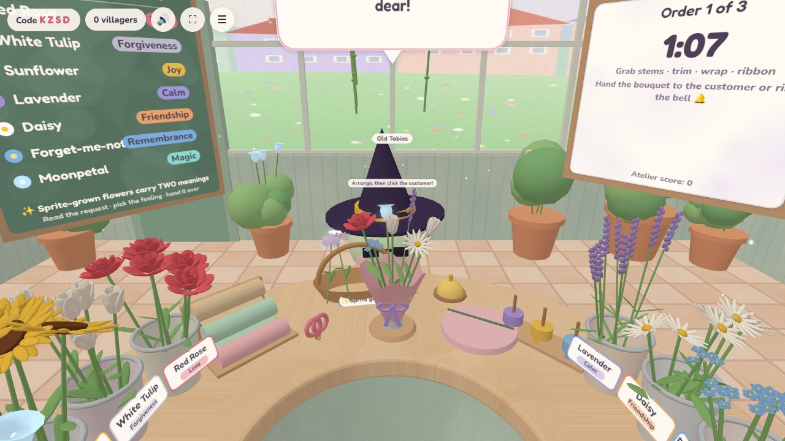
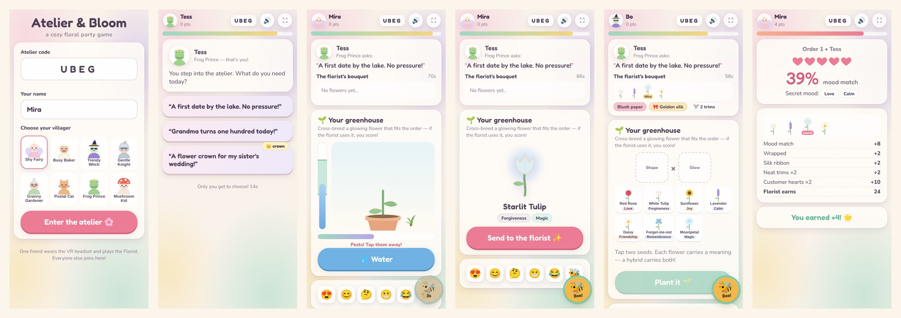

# 🌸 Atelier & Bloom — a cozy floral VR party game

**1 Florist in VR + up to 8 Villagers on their phones · 3–10 minutes · runs in the web browser (WebXR + WebSockets)**

You run a boutique flower atelier in a magical European village. Villagers walk in with heartfelt requests: *"I need something to say I'm sorry"*, *"Make me a crown for the moonlight dance!"*. The **Florist** (VR headset) hand-picks stems, trims leaves with scissors, bends wire into flower crowns, wraps bouquets in paper, ties silk ribbons and hands the result over the counter. Everyone else plays on their **phone**. Each round one of them is the **Customer** and the rest are **Garden Sprites**, who cross-breed glowing flowers in their own greenhouse and send them to the florist… or send a **cheeky bee** to steal a stem.




---

## How a game plays (≈ 1½ minutes per order, 3–5 orders)

| Phase | Florist (VR) | Customer (phone) | Garden Sprites (phones) |
|---|---|---|---|
| **Lobby** | Practises with the flowers. Rings the 🔔 bell to open the shop | Joins with the 4-letter code and picks a villager (Shy Fairy, Busy Baker, Trendy Witch…) | Can already grow flowers |
| **Request** (15 s) | A villager walks in through the door | Chooses 1 of 3 secret-mood request cards | Starts growing a flower |
| **Arrange** (75 s) | Reads the request from the speech bubble and builds a bouquet or flower crown. Hands it over or rings the bell | Sends live emoji reactions (😍 🤔 😬) that float above their head | Cross-breed → water → pull pests → **send the glowing flower** to the florist's gift basket. Send a 🐝 to steal a stem |
| **Judge** (15 s) | The customer holds (or wears!) the arrangement | Rates it with 1–5 hearts | React |
| **Reveal** (8 s) | The **secret mood** and score are shown | — | Points for used flowers |

**Every flower has a meaning**, shown on the *Language of Flowers* chalkboard and on every bucket:
Red Rose = Love · White Tulip = Forgiveness · Sunflower = Joy · Lavender = Calm · Daisy = Friendship · Forget-me-not = Remembrance · Moonpetal = Magic.
Each request hides two moods (for example *"Make peace with my baking rival"* = Forgiveness + Friendship). Sprite-grown hybrids carry **two meanings** (a *Starlit Rose* = Love + Magic), so they are worth a lot to the florist. That's why the sprites shout across the room: *"Use MY flower!"*

**Scoring**
- Florist: mood match (0–20) + craft (wrap +2, ribbon +2, neat trims up to +3, crown when one was asked for +4) + hearts × 2. At closing time the shop gets 1–5 stars and a title, from *Wilted but Hopeful* up to *Legendary Atelier*.
- Villagers: +3 for each of your flowers in a delivered bouquet (+2 more if it fits the mood, +1 if the customer gave 4+ hearts). +2 for each stem your bee steals. Customers get +2 when they're happy.
- Awards at the end: Green Thumb, Cheekiest Bee, Busiest Gardener, Toughest Critic.

No phones? The florist can also play **solo**: village regulars (NPCs) come in and rate the bouquets themselves.

---

## Controls

**VR (Meta Quest or any WebXR headset)**: you stand behind a round counter and nothing in the room ever moves you.
- **Grab** with trigger, grip, or a pinch (hand tracking). Hovering shows a label and gives a small haptic tick.
- Take a stem from a bucket and **let go above the bouquet stand** (or the wire crown) to add it. Pull a stem back out by grabbing its flower head.
- **Scissors**: grab them and move them through the bouquet to trim leaves (snip!).
- **Paper roll / ribbon spool**: grab one and bring it to the bouquet to wrap it or tie a bow.
- **Wire**: grab it and swirl your hand in circles to bend it into a crown. Then put stems on it.
- **Deliver**: grab the bouquet and push it over the counter to the customer, or touch the 🔔 bell.
- **Bees**: swat them with your hand.
- **Thumbstick up/down**: raise or lower the counter (it also auto-adjusts to your height, seated or standing).

**Desktop fallback (mouse)**: click flowers, tools and the bell. Click the customer to hand over. Drag to look around, scroll to zoom. Great for testing or when no headset is available.

**Phone**: big touch buttons, a ⛶ fullscreen toggle, vibration feedback. Works on any modern phone browser. (On iPhone, use *Share → Add to Home Screen* for real fullscreen.)

---

## Fits the competition requirements

| Requirement | How |
|---|---|
| Party game, 1 VR player + several phone/PC players | 1 florist (VR) + up to 8 villagers (phones or PCs) |
| 3–10 minutes | 3–5 orders of ~1.5–2 minutes each (5–9 minutes total) |
| HTML5, plays in the browser | Plain HTML/JS + three.js. Nothing to install for players |
| VR via WebXR | `immersive-vr` (plus an optional `immersive-ar` passthrough mode when the headset supports it) |
| No movement of the surroundings | The player never moves. Only objects move (customers, bees, sprites) |
| Scene changes only via fade through black | Opening the shop (morning → day) and closing time (day → starry evening) use a fade-through-black transition |
| No harsh flashing lights | Only soft glows that "breathe" slowly (0.25 Hz). No strobes, no sudden full-screen flashes |
| Phone: fullscreen possible | Fullscreen button + automatic fullscreen on joining + web-app manifest |
| Multiplayer | **WebSockets** (`ws`), with the server running the game flow, so it is robust even if someone reloads |

---

## Run it locally (2 minutes)

You need [Node.js](https://nodejs.org) 18 or newer.

```bash
npm install
npm start
```

- On this computer: open **http://localhost:3000**
- Phones on the same Wi-Fi: open the `http://<your-computer-ip>:3000/play` address printed in the terminal (or scan the QR code on the florist page).
- Florist: open **/florist**.

### VR headsets need HTTPS
Browsers only allow WebXR on secure (`https://`) pages. Pick one option:

1. **Deploy online** (recommended for the competition, see below). You get HTTPS for free.
2. **Local self-signed certificate**: run `npm run cert` once (needs `openssl`, which is built into macOS and Linux), then `npm start`. Open `https://<your-computer-ip>:3443/florist` in the Quest browser and accept the certificate warning once (*Advanced → Proceed*). Phones can keep using the plain http address.
3. **HTTPS tunnel**: for example `npx cloudflared tunnel --url http://localhost:3000` gives you a public `https://….trycloudflare.com` link that works for everyone.

## Put it online (free) with Render

1. Push this folder to a GitHub repository.
2. On [render.com](https://render.com), click **New → Blueprint**, choose the repository, and confirm. `render.yaml` is already included. (Or **New → Web Service** with build command `npm install` and start command `npm start`.)
3. After a minute you get a URL like `https://atelier-and-bloom.onrender.com`:
   - Headset → `https://…onrender.com/florist` → **Enter VR**
   - Phones → `https://…onrender.com/play` (they find the open atelier automatically)

The free plan goes to sleep when nobody uses it, so open the page about a minute before you present. Any Node host that supports WebSockets works the same way (Railway, Fly.io, Koyeb, a VPS…).

**Tip for parties and presentations:** use the Quest's built-in *Cast* feature to show the florist's view on a TV or laptop, so everyone sees the bouquet being made.

---

## Project structure

```
server.js                  HTTP static server + WebSocket game server (rooms, phases, timers, scoring, NPCs)
public/
  index.html               landing page (choose Florist or Villager)
  florist.html             VR / desktop florist client
  phone.html               phone controller
  js/shared/data.js        flowers, meanings, requests, villagers, scoring — shared by server & clients
  js/florist/              three.js scene: world (greenhouse + painted village), bench (tools & arrangement
                           logic), flowers (procedural), villagers, bees, panels, input (WebXR + mouse)
  js/phone/                phone UI + greenhouse cross-breeding mini-game
  js/audio.js              procedural "acoustic guitar" music + sound effects (no audio files)
  js/net.js                WebSocket client with auto-reconnect / resume
  vendor/three/            three.js r186 (MIT)
  fonts/                   Fredoka & Nunito (SIL Open Font License)
scripts/make-cert.mjs      optional local HTTPS certificate
render.yaml                one-click deploy on Render
```

Everything visual is generated in code: watercolour textures come from Canvas2D, the flowers and villagers are procedural geometry, and the music is synthesised Karplus–Strong plucked strings. So the game has no copyrighted assets and loads fast on standalone headsets (~110 draw calls).

---

## Ideas for future development
- **Greenhouse tab for the florist** between days: plant the seeds the sprites unlocked, and grow rare colours (persistent progression).
- **Story mode**: recurring villagers with little arcs (the shy fairy finally confesses; the dragon cheers up).
- **More crafts**: corsages, wreaths, vases with water levels, potted arrangements, sprays of glitter dew.
- **Seasonal events**: Moonlight Festival, Winter Solstice, with special requests and decorations.
- **Spectator / TV mode** with the villagers' scores and a live 2D bouquet view.
- **More phone mini-games**: rival sprites racing to pollinate, a "guess the mood" betting round.
- **Bulgarian / multilingual text** (all strings live in `shared/data.js` and the two clients).
- Voice requests: the customer records a short voice message that plays in the shop.

## Credits
Made with three.js (MIT), ws (MIT), qrcode (MIT), Fredoka & Nunito fonts (OFL). Built with the help of AI (Claude).
